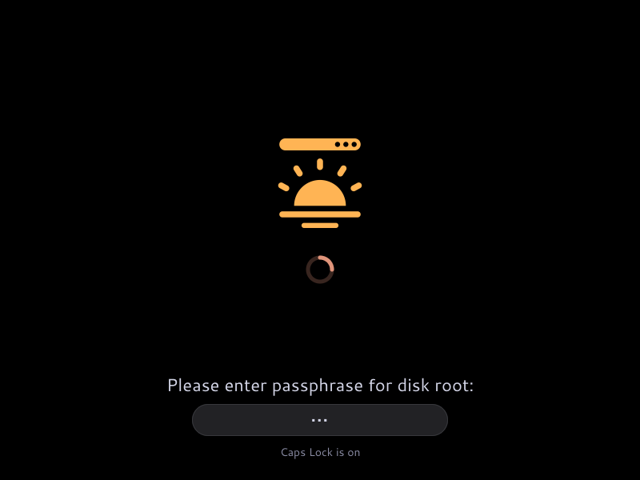

# Configuration and themes

The only configuration file is the theme: `/etc/lys-splash/theme.yaml`, or the
file `--theme` names. Without it the defaults apply; a field left out keeps its
default. The colour defaults are the desktop's default palette (`desktop/tokens`),
the same one the lys-login greeter and lock screen draw with.

| Field | Values | Default | Effect |
| --- | --- | --- | --- |
| `background` | `#rrggbb` | `#000000` | Background colour |
| `foreground` | `#rrggbb` | the palette's text colour | Message and prompt text |
| `secondary` | `#rrggbb` | the palette's muted text colour | Unit names, the disk under a prompt, placeholder and prompt hints |
| `accent` | `#rrggbb` | the palette's primary colour | The lys logo, the throbber, progress bars and the lock over a prompt |
| `error` | `#rrggbb` | the palette's red | The field's ring and the "Incorrect passphrase" line when a disk asks again |
| `logo` | `firmware`, `lys` | `firmware` | `firmware`: the firmware's logo (ACPI BGRT) if it left one on screen, else lys's. `lys`: always lys's |
| `throbber` | `spinner`, `dots` | `spinner` | Busy animation |
| `units` | bool | `false` | Shows the name of each unit systemd starts on its own line under the message, in the secondary size and colour |
| `prompt-hints` | bool | `true` | Adds "Caps Lock is on" and the console keymap to the hints under a prompt's field, beside "Esc: boot messages" |
| `reduced-motion` | bool | `false` | Cuts instead of fading: no fade in from the firmware, no crossfade between states, no fade out before a hand-over or the power going, and the lys-login greeter replaces the splash's last frame in one cut |

The default background is black so the firmware's logo, drawn on black, blends
in. The lys logo is drawn in the `accent`, the palette's primary colour by
default, and the text in Inter Regular, the desktop's default font; the splash
records the logo's colour for the greeter, which takes over in the same colour
and typeface. The logo image, the font, the scale and the length of the fades
are not configurable;
[Fades](/splash/guide/how-it-works#fades) lists them.

```yaml
accent: "#7aa2f7"
throbber: dots
units: true
```

`prompt-hints`:



`throbber: dots`:


## Applying it

| System | How |
| --- | --- |
| NixOS | Set `boot.lys-splash.theme` (same fields); the module writes the file into the initrd and the system |
| Ubuntu, Debian | Edit `/etc/lys-splash/theme.yaml`, then `sudo update-initramfs -u` so the hook copies it into the image |
| Running splash | `lys-splash reload` re-reads the file |

```nix
{
  boot.lys-splash.theme = {
    accent = "#7aa2f7";
    throbber = "dots";
  };
}
```

## Invalid themes

A theme with an unknown field, a colour that is not `#rrggbb` or a value outside
its list is rejected whole: the splash logs a warning naming the file, line and
field, and draws the embedded theme. The NixOS option is not validated at build
time. See [where the logs are](/splash/guide/install#check-that-it-works).
