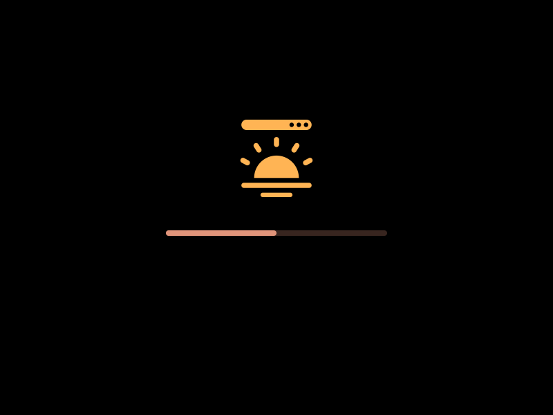
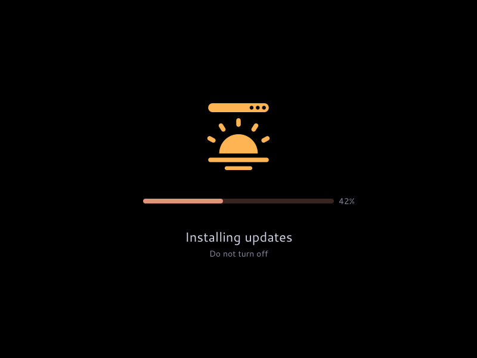
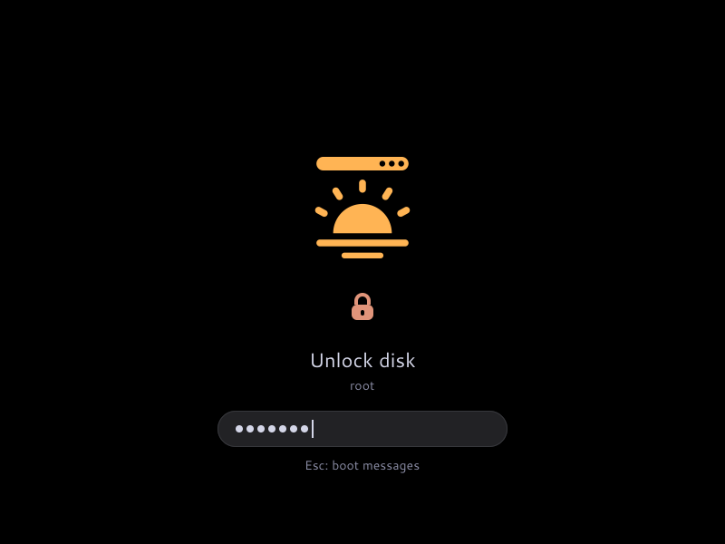
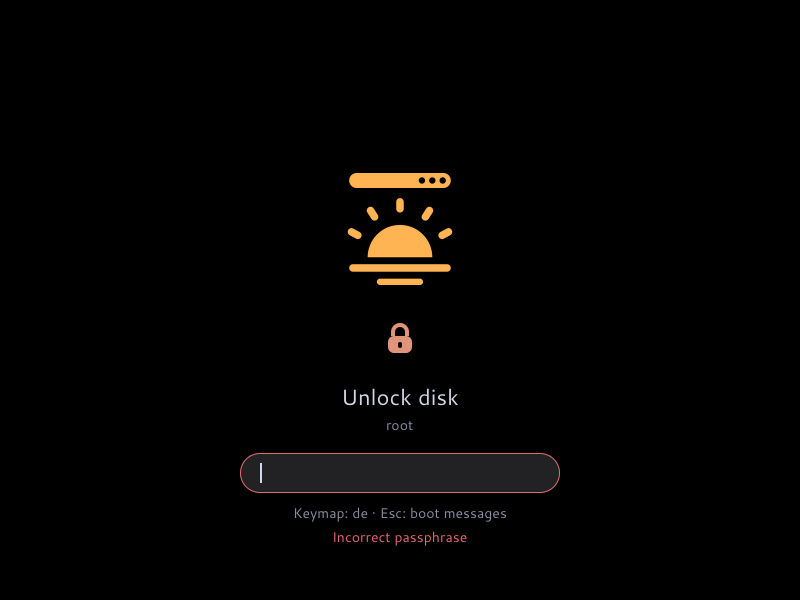

# Getting started

lys-splash is the lys desktop's boot splash and replaces Plymouth; the two do
not run side by side. It shows from the initrd until the display manager or the
login prompt takes over, asks for disk passwords, and shows again on shutdown,
reboot and kexec.

## What you see

- **Logo:** the firmware's own logo if it left one on screen, otherwise lys's.
- **One indicator under it:** the throbber (a spinner with a fading tail, or
  three dots; see the [theme](/splash/guide/configuration)) until the progress
  is known, then the progress bar in its place.
- **Progress bar:** this boot's elapsed time against the previous boot's
  duration, moving a pixel at a time. It stays short of full until the splash
  quits and never moves back. Without a recorded previous boot the throbber
  stays.
- **Message and status:** one line each under the indicator; a line too long
  for the screen ends in "…" rather than wrapping.
- **Updates** (`--updates`, `--system-upgrade`, `--firmware-upgrade`): the
  throbber until the first percentage arrives, then the bar easing to each
  new value, the percentage beside it and "Do not turn off" under the message:

- **Password prompt** when a disk needs one. It takes the throbber's place
  under the logo: a breathing lock, "Unlock disk" with the disk's name under
  it (cryptsetup's own text when it is not one the splash knows), a field
  with a dot per character and a blinking caret, and the hints:

- **A refused passphrase:** when a disk asks again, the field turns red, shakes
  briefly and "Incorrect passphrase" shows under it:

- **Questions** take the same place, with the answer shown as it is typed.

Shutdown, reboot and kexec show the logo and throbber until the power goes.

## Keys

| Key | Action |
| --- | --- |
| <kbd>Esc</kbd> | Toggles the boot messages |
| <kbd>Enter</kbd> | Answers the prompt |
| <kbd>Backspace</kbd> | Deletes the last character |
| <kbd>Ctrl</kbd>+<kbd>C</kbd>, <kbd>Ctrl</kbd>+<kbd>D</kbd> | Abandons the prompt |

Keys are read from the active virtual terminal and follow the console keymap.

## Next

1. [Install](/splash/guide/install) it.
2. Reboot. To boot once without it, add `plymouth.enable=0` to the kernel
   command line.
3. Adjust colours, logo or throbber in [`theme.yaml`](/splash/guide/configuration).

::: warning Not on a running desktop
The daemon takes DRM master on every card and the active virtual terminal.
Starting it by hand takes the display from your session. Try it in a VM.
:::
