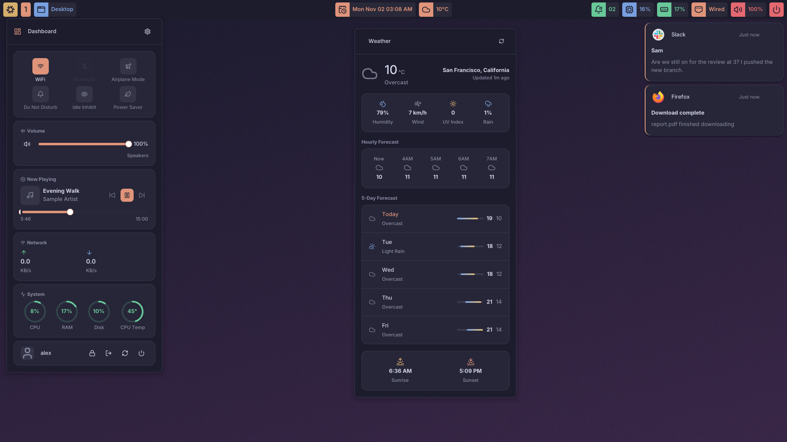

<p align="center">
  
</p>

<h1 align="center">lys-shell</h1>

<p align="center">
  The desktop shell of <a href="../README.md">lys</a>, in pure Go: bar, notifications, OSD, launcher, wallpaper, and a desktop portal.
</p>

<p align="center">
  <a href="https://stubbedev.github.io/lys/shell/">Documentation</a>
</p>

<p align="center">
  
</p>

lys-shell runs on any compositor with `wlr-layer-shell`, including but not limited to [lys-wm](../wm). It is built on [lys-ui](../ui).

## Install

The manual's [install section](https://stubbedev.github.io/lys/install/) covers NixOS (`lys.nixosModules.lys-shell`, `lys.homeModules.lys-shell`), the Debian, Ubuntu and Fedora packages and the tarball. [Getting started](https://stubbedev.github.io/lys/shell/guide/getting-started) lists the runtime dependencies and the build from source.

## Usage

```sh
lys-shell panel start     # run the shell in the background
lys-shell panel settings  # open lys-settings
```

The config is `~/.config/lys-shell/config.yaml`; changes apply on save:

```yaml
bar:
  layout:
    - monitor: "*"
      left: [dashboard, hyprland-workspaces]
      center: [clock]
      right: [volume, network, bluetooth, battery]
```

## Documentation

The guides, the CLI and the config reference are in [the manual](https://stubbedev.github.io/lys/shell/). For development, see [CLAUDE.md](CLAUDE.md).

## Credits

The configuration format and much of the design come from [wayle-rs/wayle](https://github.com/wayle-rs/wayle). lys-shell shares no code with it.

## License

[MIT](LICENSE)

The passphrase generator embeds the words of the EFF large wordlist by the Electronic Frontier Foundation, under the Creative Commons Attribution 3.0 United States License; see [eff_large_wordlist.NOTICE](service/bitwarden/generator/eff_large_wordlist.NOTICE).
