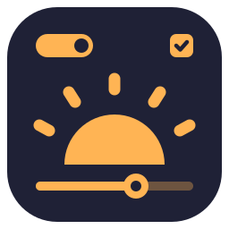

<p align="center">
  
</p>

<h1 align="center">lys-ui</h1>

<p align="center">
  The widget toolkit of <a href="../README.md">lys</a>, for Wayland, in pure Go (no cgo): a
  <a href="https://relm4.org">relm4</a>-style component framework with typed
  messages, GTK4/libadwaita-class widgets, xdg-shell and layer-shell
  windows, a GTK-flavoured CSS engine and an event loop that idles at
  0% CPU.
</p>

<p align="center">
  <a href="https://stubbedev.github.io/lys/ui/">Documentation</a>
</p>

<p align="center">
  
</p>

## Install

```sh
go get github.com/stubbedev/lys
```

## A minimal app

```go
package main

import (
	"log"
	"strconv"

	"github.com/stubbedev/lys/ui/app"
	"github.com/stubbedev/lys/ui/component"
	"github.com/stubbedev/lys/ui/ui"
	"github.com/stubbedev/lys/ui/widget"
)

type Msg int

const (
	Increment Msg = iota
	Decrement
)

type Counter struct {
	env ui.Env
	n   int
}

func (c *Counter) Init(cx *component.Context[Msg, int]) widget.Widget {
	return ui.Mount(cx, c.env, ui.Row(
		ui.Button(ui.Label("-"), 8, 6).OnClick(func() { cx.Input(Decrement) }),
		ui.Expand(ui.Label("").WatchText(func() string { return strconv.Itoa(c.n) })),
		ui.Button(ui.Label("+"), 8, 6).OnClick(func() { cx.Input(Increment) }),
	).Spacing(6))
}

func (c *Counter) Update(cx *component.Context[Msg, int], msg Msg) {
	switch msg {
	case Increment:
		c.n++
	case Decrement:
		c.n--
	}
	cx.Output(c.n)
}

func main() {
	err := component.Run(app.WindowConfig{Title: "counter", AppID: "dev.example.counter"},
		func(a *app.Application) (*Counter, error) {
			face, err := app.Font("sans-serif", 15)
			if err != nil {
				return nil, err
			}
			if err := a.AddAccel("Escape", widget.NewAction("quit", a.Quit)); err != nil {
				return nil, err
			}
			return &Counter{env: ui.Env{Face: face, Size: 15}}, nil
		})
	if err != nil {
		log.Fatal(err)
	}
}
```

This program is `ExampleRun` in `component/example_test.go`.

## Documentation

[The manual](https://stubbedev.github.io/lys/ui/):
[getting started](https://stubbedev.github.io/lys/ui/guide/getting-started),
[widgets](https://stubbedev.github.io/lys/ui/widgets),
[demos](https://stubbedev.github.io/lys/ui/guide/demos),
[development](https://stubbedev.github.io/lys/ui/guide/development)
and the reference.

## License

MIT
